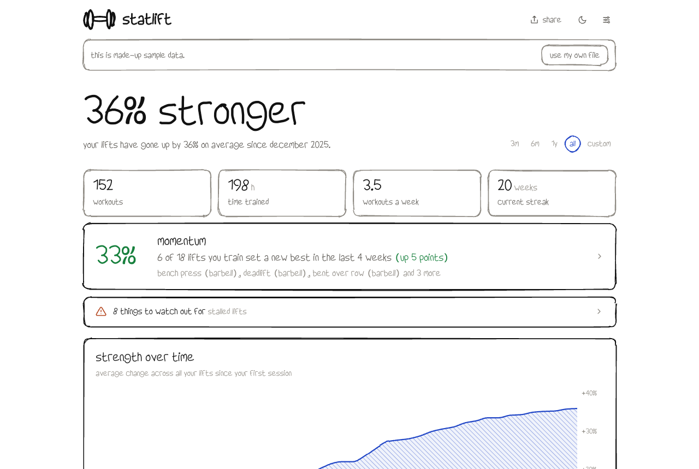
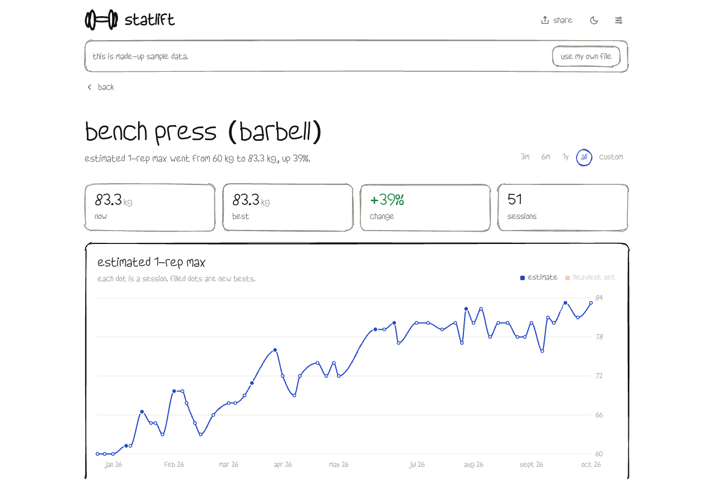
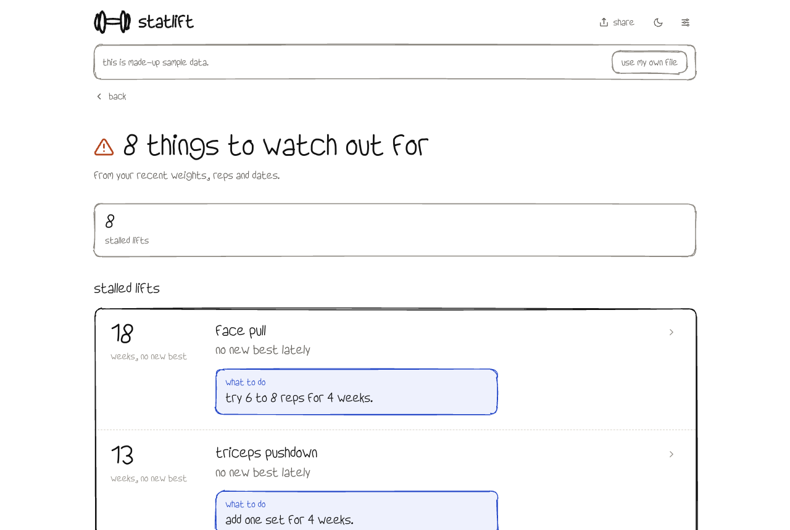
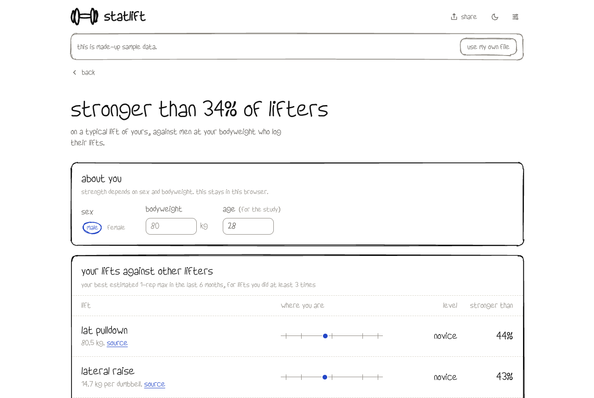
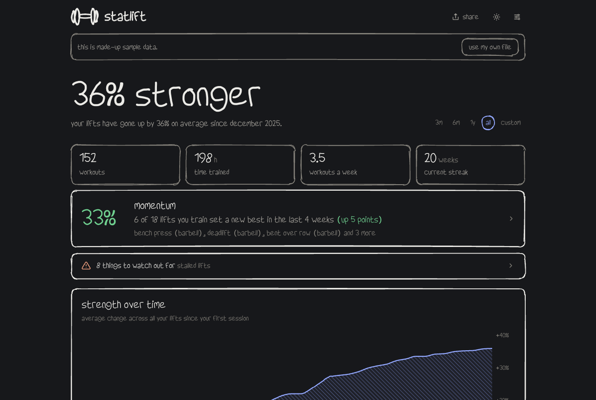

<p align="center">
  <picture>
    <source media="(prefers-color-scheme: dark)" srcset="docs/logo-dark.svg">
    
  </picture>
</p>

<h1 align="center">Statlift</h1>

<p align="center">
  See how strong you have become. A hand-drawn dashboard for your <a href="https://www.hevyapp.com">Hevy</a> workout history.
</p>

<p align="center">
  
  
  
  
</p>

<p align="center">
  
</p>

## What it is

Export your workouts from Hevy, drop the CSV on the page, and Statlift shows how your training has changed: how much stronger you are, which lifts still move, which ones have stalled, and what to do about it.

Everything runs in your browser. The file is never uploaded; there is no server and no account.

## Features

- **Strength over time.** One index that follows all your lifts, set to "start" at your first session, with an estimated 1-rep max for every lift.
- **Momentum.** The share of the lifts you train now that set a new best in the last 4 weeks.
- **Watch out.** Plain rules over your log that flag lifts going backwards, stalled lifts, weight jumps that are too fast, too few or too many sets, and push/pull/legs balance. Each one comes with a short tip.
- **Compare.** Your best lifts against real data from other lifters at your bodyweight, with a level, a percentile and a link to the source.
- **Records, calendar, body balance and habits.** Every new best, a training heatmap, sets per muscle and when and how long you train.
- **Share card.** Save a clean image of your progress.
- **Details that matter.** kg and lb, warm-up sets left out, cardio and timed sets, muscle mapping you can fix per lift, date ranges, light and dark mode, and a plain font option.

<table>
  <tr>
    <td></td>
    <td></td>
  </tr>
  <tr>
    <td></td>
    <td></td>
  </tr>
</table>

## Get started

You need [Node.js](https://nodejs.org) 20 or newer.

```bash
git clone https://github.com/SohamKukreti/statlift.git
cd statlift
npm install
npm run dev        # opens on http://localhost:5173
```

No Hevy file yet? Click **Try sample data**. It loads a made-up lifter so you can look around.

### Export your data from Hevy

In the Hevy app: **Profile → Settings → Export & Import Data → Export Workouts**. You get one CSV file. Both kg and lb exports work.

### Build and deploy

```bash
npm run build      # static site in dist/
npm run preview    # serve the build locally
```

`dist/` is plain static files, so any static host works (Vercel, Netlify, Cloudflare Pages, GitHub Pages). Pages use hash links (`#/records`), so no server rewrite rules are needed.

## How the numbers work

| Number | How it is made |
| --- | --- |
| Estimated 1-rep max | Epley formula, `weight × (1 + reps / 30)`, from the best working set of a session. Sets over 15 reps are not used. |
| New best | A session whose estimate beats every earlier session of that lift. Bodyweight lifts use reps. |
| Strength over time | Each lift is set to 100 at its first session. Each week shows the average of your lifts' running best. |
| Momentum | Lifts done in the last 4 weeks, and at least twice before, that set a new best in those 4 weeks. |
| Watch out | Fixed rules, all looking back from today. For example, "stalled" means 4 or more sessions in 6 weeks and no new best for 8 weeks. See [`src/lib/watch.ts`](src/lib/watch.ts). |
| Compare | Your best estimate in the last 6 months, placed between the levels for your sex and bodyweight. Lifts need at least 3 sessions. |

### Data sources for Compare

- **[Strength Level](https://strengthlevel.com/strength-standards).** Strength standards built from millions of 1-rep maxes that users log on the site. Each level stands for a share of lifters: beginner 5%, novice 20%, intermediate 50%, advanced 80%, elite 95%. These are people who track their lifts, so they are stronger than the general public.
- **The Cooper Institute** bench press norms by age and sex, as printed in the American Council on Exercise [1-RM Bench-Press Assessment Protocol](https://www.acefitness.org/images/webcontent/assets/certification/ace-answers/forms/pt/38_Bench-Press_Assessment_Protocol.pdf).

Each lift on the Compare page links to the exact table it uses. Machine lifts vary between gyms, so treat those numbers as rough.

## Privacy

- Your CSV is read in the browser with [Papa Parse](https://www.papaparse.com) and never sent anywhere.
- The last file you loaded, your settings and your Compare profile (sex, bodyweight, age) are kept in your browser's local storage so they are there next time. **Settings → Remove my data from this browser** clears them.
- There are no analytics and no cookies.

## Project structure

```
src/
  lib/
    parse.ts        CSV → workouts: date formats, kg/lb, set types
    analytics.ts    1-rep max, new bests, streaks, strength index, momentum
    watch.ts        the watch-out rules
    compare.ts      places your lifts against the standards
    standards.ts    the Strength Level and Cooper Institute tables, with sources
    muscles.ts      exercise → muscle rules (you can override them in the app)
    sample.ts       the made-up lifter behind "Try sample data"
  components/
    Sketch.tsx      hand-drawn box outlines (roughjs) and hatch fills
    Logo.tsx        the dumbbell
  screens/          Home, Lift, Lifts, Records, Calendar, Balance, Habits, Watch, Compare
```

## Built with

[React](https://react.dev), [TypeScript](https://www.typescriptlang.org), [Vite](https://vite.dev), [Recharts](https://recharts.org), [roughjs](https://roughjs.com) for the hand-drawn lines (the same library [Excalidraw](https://excalidraw.com) uses), [Papa Parse](https://www.papaparse.com) and [html-to-image](https://github.com/bubkoo/html-to-image).

Fonts: My-Hand, Lora and Recursive Mono Casual. See [`src/assets/FONTS.md`](src/assets/FONTS.md).

## Contributing

Issues and pull requests are welcome. Before you open a pull request:

```bash
npx tsc -b         # type check
npm run build      # make sure it builds
```

Please never commit a real workout export. `*.csv` is ignored on purpose.

## Disclaimer

Statlift is not affiliated with Hevy. Its tips come from simple rules over your log, not from a coach. It sees your weights, reps and dates, not your form.
